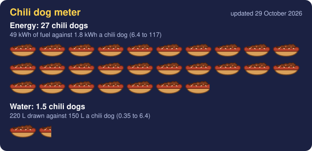

# 3D Sonic 3D Blast 3D³ 

This is the game that would've saved the Saturn.

A true 3D take on an isometric Mega Drive platformer, playable in your browser. It reads the level layouts, level
art and sprites from **your own copy** of the Mega Drive *Sonic 3D Blast* ROM, and falls back to crude original
scribbled art and a built-in level when you have no ROM. Shamlessly vibe coded with Claude because I have absolutely no skills to do any of this.  

<!-- footprint -->
[](https://s3lfish.github.io/3D-Sonic-3D-Blast-3D/footprint/)

Making this with Claude, counted in chili dogs. [Pick which parts to count](https://s3lfish.github.io/3D-Sonic-3D-Blast-3D/footprint/), or read [how it works](#how-the-chili-dog-meter-works).
<!-- /footprint -->

## ▶ [Play it in your browser](https://s3lfish.github.io/3D-Sonic-3D-Blast-3D/)

No install. Works with keyboard, mouse, touch or a controller.

## Using your ROM

1. Open the game and choose **Choose ROM file** at the top of the start card. A plain ROM (`.bin`, `.md`), an `.smd` dump, or
   either one inside a `.zip` all work.
2. Pick a level, choose **True shape** to experience the true majesty of THREE DIMENSIONS or **Half height** so that it's actually playable, and press **Play this level**.

The page reads the ROM with JavaScript in your browser and keeps a copy in the browser's own storage (IndexedDB) so the sprites load next time; **Forget ROM** removes it. This repository contains
no ROM data, no extracted levels and no pictures made from the ROM: only the rules for reading it.

Known good ROM: SHA-1 `89957568386a5023d198ac2251ded9dfb2ab65e7` (the 4 MB Mega Drive release). Other releases are
untested.

## Controls

| Input | Action |
| --- | --- |
| WASD / arrows | Move |
| Space or J | Jump (hold for height) |
| Shift or K | Hold while still to charge a spin dash, release to launch; tap while running to roll |
| Mouse drag | Look around |
| Q / E | Swing the camera |
| Mouse wheel | Camera distance |
| V | Switch between the chase camera and the isometric view |
| R | Restart |
| Controller | Left stick moves, right stick looks, A jump, B or X dash, LB/RB swing, Y or Back switches view, right stick click recentres, Start pauses |

## What works

- All 22 levels' terrain, start points, rings, springs, monitors, big rings and most enemies.
- The original level art unprojected onto the 3D faces, with its water, waterfalls and lava animated as in the original;
  foliage as standing sprites (each flower on its own patch of ground), plain rock on cliffs the original never shows, zone skies.
- Movement measured in the original (jump height, spring height, gravity, step height; edges are walls).
- Green Grove sections: Flickies freed from enemies open each big ring; holes carry you to the next section;
  cracked walls break when you spin dash into them, and the cannons fire you across the level as in the original.
  Reaching the last ring ends the act and moves on to the next one.
- Rusty Ruin 1 and 2: fans that set you whirling (it breaks pillars and enemies), spike blocks, doors, slides,
  trampolines, sinking slabs, teleport pads, maces, flamethrowers, and the original's own scripted rides through
  tunnels and arches.
- Spring Stadium: superchargers into loops and dash runs, floor springs, bumpers and triangle bumpers, spike fields
  that rise when you stand still, spears, twisted tunnels, balloons to bounce on, and the boss with its spring fists.
- Diamond Dust 1 and 2: slippery ice, ice spikes you break with a spin dash, the ice chute, sled runs, currents that
  carry you towards spikes, snowdrift springs, bumpers, dash runs, low roofs, and snowblowers that freeze you.
- Volcano Valley 1 and 2: lava that burns unless you carry the fire shield, lava spouts and running fireballs, rocks
  to bounce off, vents that throw you out of another, jet lifts, moving platforms, swinging spiked balls, walls of fire,
  cracked walls, and its scorpions and dragons.
- Gene Gadget 1: floors that float you over them, floors that spark under your feet, pyramid bumpers, electric
  barriers that switch off at the big ring, sprinklers, the supercharger run round the arch, and glass tubes between
  the platforms (the last one takes you to the end only with five Flickies).
- Gene Gadget 2: the long chute that rolls you down into a leap, moving platforms over the conveyor slopes, doors
  that open for the tube you came out of, spikes, and the supercharger run that jumps you up a level.
- Panic Puppet 1: levers that turn the belts round, belts that carry you (one throws you down a hidden run to a door
  that opens only for it, one runs through a tunnel to the act's ring), Flicky capsules to jump on, the robots that
  patrol and shoot all four ways, tubes inside the walls, a door the tube opens, and a cracked wall to spin dash through.
- Panic Puppet 2: belts that throw you down to the floor below, doors that slam shut behind you, posts that fire
  bursts across the corridors, wandering robots, lifts that rise while you stand on them, and the lift at the end.
- On levels from your ROM, Sonic moves by the original's own rules: how fast he speeds up, stops, turns, slides on
  ice, rolls (bouncing off walls and turning on corner pieces), and how hard each spin dash launches him.
- Monitors show their icon and give rings, a shield, a gold shield, invincibility, speed shoes or a 1-up.
- The Green Grove, Rusty Ruin, Spring Stadium, Diamond Dust, Volcano Valley, Gene Gadget and Panic Puppet bosses, moving as the original's routines move them: in Rusty Ruin, ride a stone
  fist up after it slams and jump at the pod; in Diamond Dust, keep clear of the snow its blowers puff (it freezes
  you) and of its snowmen, and jump on it while it is low; in Volcano Valley, land on the pod in the crater and
  outrun the fire serpent; in Gene Gadget, keep off the end of the belt, dodge its loads and the bombs, and jump on the
  pod when it comes down; in Panic Puppet, three arenas of arms that punch, sway, set a serpent on you and spray
  shots: jump at an arm's shoulder while it rests, then ride the lift to the next arena.
- The Final Fight: Robotnik's machine fights you in four rooms and a corridor, twice round, ten hits: lasers along
  your row, a fire serpent, two spiked fists that slam and then slide apart, bombs that fall on where you stand, and
  a pod whose cannon sprays bouncing balls. Each time it comes close, jump on it. Doors shut you in; once it is hit,
  you have ten seconds to reach the next room. (The machine is our own model: the original draws it from tiles the
  game unpacks as it plays.)
- Mines, Turrets, chasing enemies, Hunters with their circling spike balls, and superchargers (stand on one and press jump).
- Tails and Knuckles (or, in the scribbled look, two pals of our own): give one fifty rings in an act and you go to
  the special stage, run by the original's own rules from your ROM and drawn in 3D: a stone path over lava or a
  steel grating over a river, rings to collect, spiked balls to dodge and steps to jump, gates that want 50, 100 and
  150 rings, and a Chaos Emerald at the end. With all seven, the Final Fight follows Panic Puppet 3.
- Three lives, 1-ups from monitors; a death puts the act back as it was (rings, enemies, monitors) and you start
  again at the last big ring, as in the original. Ten Sonic heads (often high over a spring) make a continue; with
  no continue left it is game over.
- The original's act results screen, with its own bonuses, then the next act.
- With your own Sonic Jam (Saturn) disc image (.chd, .iso, .bin, .img, .mdf, .nrg, .ecm, or zipped): a 3D Sonic using the Saturn game's own model, textures and moves
  (including his skid), and Sonic World's palm trees, springs, big ring and Flickies in place of the flat sprites.
- A Saturn screen option: low resolution, wobbly textures, and checkerboard see-through effects.
- With your ROM: the original music and sound effects, played by an emulated Mega Drive sound chip running the
  game's own sound program from your ROM. Without a ROM: simple sound effects made in the browser. M turns sound off.

Not done yet: see `re/NOTES.md` for what is known and what is not.

## Working on it

The page is one self-contained file, `index.html`, built from `src/`:

- `src/s3d.js`: reads the ROM (decompression, level maps, level art bake, sprites). Rules only, never ROM bytes.
- `src/game.js`: rendering, camera, input, HUD (Three.js r128 from a CDN).
- `src/art.js`: the scribbled fallback art, drawn in code.
- `sound/md_sound.c`: the Mega Drive's sound hardware (Z80, YM2612, SN76489) for WebAssembly, built with
  `sh sound/build.sh` (needs clang with the wasm32 target) into `src/md_sound.wasm`, which `tools/build.py` embeds.
  Third-party parts and their licences are listed in `third_party/README.md`.
- The simulation lives in the `#sim` script inside `index.html` and is edited there.

```sh
python3 tools/build.py          # rebuild index.html from src/
npm install                     # playwright, sharp, three@0.128.0 for the browser tests
npm test                        # simulation tests (Node only)
npm run test:render             # headless render check, screenshots in test-out/
npm run test:pad                # fake controller test
```

To try changes, serve the folder (for example `python3 -m http.server`) and open `http://localhost:8000/`.

`CLAUDE.md` is a terse project map kept for coding agents; it doubles as a list of conventions and past mistakes.

## Reverse-engineering notes and tools

`re/` holds the notes (`re/NOTES.md`) and the Python reference tools used to work out the formats: RNC unpackers,
the reference level converter and art bake that the browser code is checked against byte for byte, sprite
decoders, and emulator probes used to measure movement. Put your own ROM at `re/rom/s3d.bin` (ignored by git) and
run the tools from inside `re/`. Their outputs stay on your machine; please keep it that way.

## Contributing

Pull requests welcome. Two hard rules:

1. Never commit ROM bytes, extracted maps, ROM-derived binaries, emulator states, or screenshots and renders of the
   original art. `re/leakcheck.py` checks the page; run it before you push.
2. Keep the fallback hero clearly original. No look-alikes of existing characters.

## Credits

The Sonic Jam model, animation and texture formats come from the Sonic Community Hacking Guide on Sonic Retro
(SCHG: Sonic Jam). Sega's data is never included: the page reads it from the player's own disc image.

## Licence and disclaimer

GPL-3.0 (see `LICENSE`). Copyright 2026 Bill Page and contributors. The sound emulation includes a Z80 core
(zlib licence) and Nuked-OPN2 (LGPL-2.1); see `third_party/README.md`.

This is an unofficial fan project, not affiliated with or endorsed by Sega or Sonic Team. Sonic the Hedgehog and
Sonic 3D Blast are trademarks of Sega. You need your own legally obtained copy of the game to use the ROM features.

## How the chili dog meter works

The meter at the top compares the energy and water used to make this game with Claude against the energy and water
used to make chili dogs. Every figure is a rough estimate: the true numbers could be about four times lower or higher.
[The meter's page](https://s3lfish.github.io/3D-Sonic-3D-Blast-3D/footprint/) lets you choose which parts of each life
cycle to count. `tools/footprint.py` updates it as the work goes on.

**A fair comparison** counts the same kinds of thing on both sides:

- Energy is counted as fuel at the source. The food figures already count the diesel, gas, and electricity used from
  farm to plate. The game's electricity is multiplied by 1.9, the EU's default for how much primary energy each
  delivered kWh takes.
- Water is counted as water drawn from rivers and aquifers and not returned: cooling water at the data centre and the
  power station, and irrigation water for the food. Rain falling on the fields, and the water needed to dilute farm
  run-off, are left out by default, because the data centre has nothing like them.
- Both sides count making the thing, not just the last step. The game includes a share of training the model and of
  making its chips and servers. The chili dog includes raising the cattle, growing the wheat, and processing,
  shipping, and cooking.
- Claude's thinking is counted: each call's output tokens include the reasoning written before the answer, and every
  token re-read from earlier in the conversation counts as well.

**Making the game with Claude**

| Part | How it is estimated |
| --- | --- |
| Running the model | Every call Claude made, token by token from its session logs: 0.1 to 0.25 mWh for each new input token (Epoch AI's 2.5 Wh for a 10,000-token prompt), 0.5 to 5 mWh for each output token written over a long context (long-prompt and reasoning estimates, 1.8 to 39 Wh a query), and 0.001 to 0.01 mWh for each token read back from the prompt cache (my estimate). The first three days left no log: 2,000 to 8,000 calls at 1.2 to 7 Wh each. |
| Training the model | Google's machine learning energy splits two fifths training, three fifths use, so training adds two thirds of the running energy. Claude's own split is not published. |
| Chips and servers | Mistral's life cycle study of its own model: making the hardware caused 11% of the emissions and 5% of the water, against 85.5% and 91% for training and use. This is the roughest part. |
| The test machine | The cloud machine that ran the emulator and tests for about 40 hours: 1 to 2 kWh (my estimate). |
| Cooling water | 0.26 mL for every 0.24 Wh, Google's figure for a median Gemini prompt. |
| Power station water | 7.6 L for every kWh generated (US average, 2003 generation mix; likely high today). |

**Making one chili dog**: a 50 g beef frank, 60 g of chili holding 25 g of beef, and a 50 g bun. The beans and tomato
in the chili are left out.

| Part | Energy | Water drawn | Rain and run-off |
| --- | --- | --- | --- |
| 75 g of beef | 210 MJ/kg of non-renewable energy, farm to plate (US beef study) | 4% of 15,415 L/kg | the other 96% |
| 50 g bun | 20 MJ/kg, the middle of 9 to 33 MJ/kg for 21 EU breads | 10% of 1,608 L/kg (assumed) | the other 90% |
| Cooking | 0.1 kWh: a 1 kW grill for 6 minutes (assumed) | its power station water | none |

**Sources**

- Google: [Measuring the environmental impact of delivering AI at Google scale](https://arxiv.org/abs/2508.15734), and [the carbon footprint of machine learning training](https://research.google/blog/good-news-about-the-carbon-footprint-of-machine-learning-training/) (training and use split)
- [IntuitionLabs: AI inference energy per task](https://intuitionlabs.ai/pdfs/ai-inference-energy-joules-per-task.pdf) (collects Epoch AI, Jegham et al., Microsoft, and OpenAI)
- Mistral's life cycle study, as reported by [Simon Willison](https://simonwillison.net/2025/Jul/22/mistral-environmental-standard/)
- Shehabi et al. (2016), US data centre energy, via [David Mytton](https://davidmytton.blog/how-much-water-do-data-centers-use/) (power station water)
- European Parliament: [revising the primary energy factor for electricity](https://oeil.europarl.europa.eu/oeil/en/document-summary?id=1727943)
- Asem-Hiablie et al. (2019): [a life cycle assessment of the US beef value chain](https://link.springer.com/article/10.1007%2Fs11367-018-1464-6)
- [Energy flows of EU national breads](https://agris.fao.org/search/en/records/68879c487fd4d06c32a97929)
- Heinrich Böll Foundation, Meat Atlas: [beef 15,415 L/kg](https://eu.boell.org/en/2021/09/07/water-thirsty-animals-thirsty-crops); [NFU](https://www.nfuonline.com/updates-and-information/water-use-and-beef-what-we-know): about 4% of it is irrigation water; [Enel](https://www.enel.com/learning-hub/environment/water-footprint): bread 1,608 L/kg
